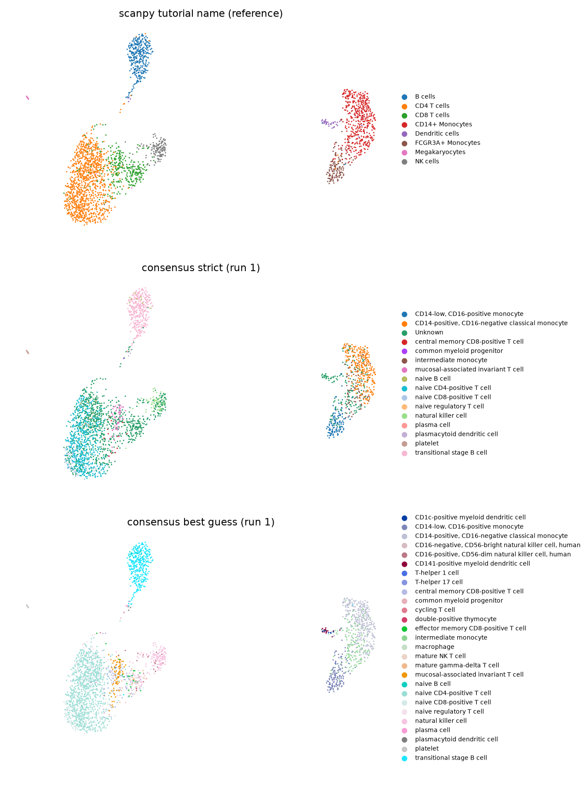
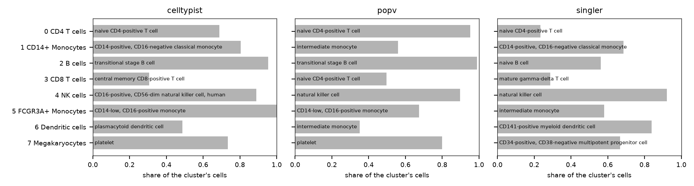
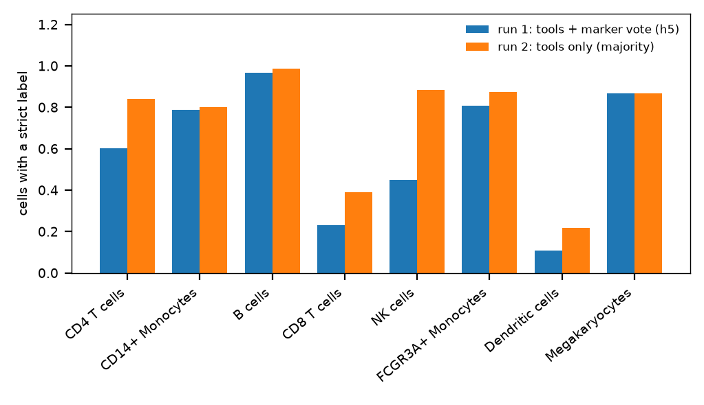
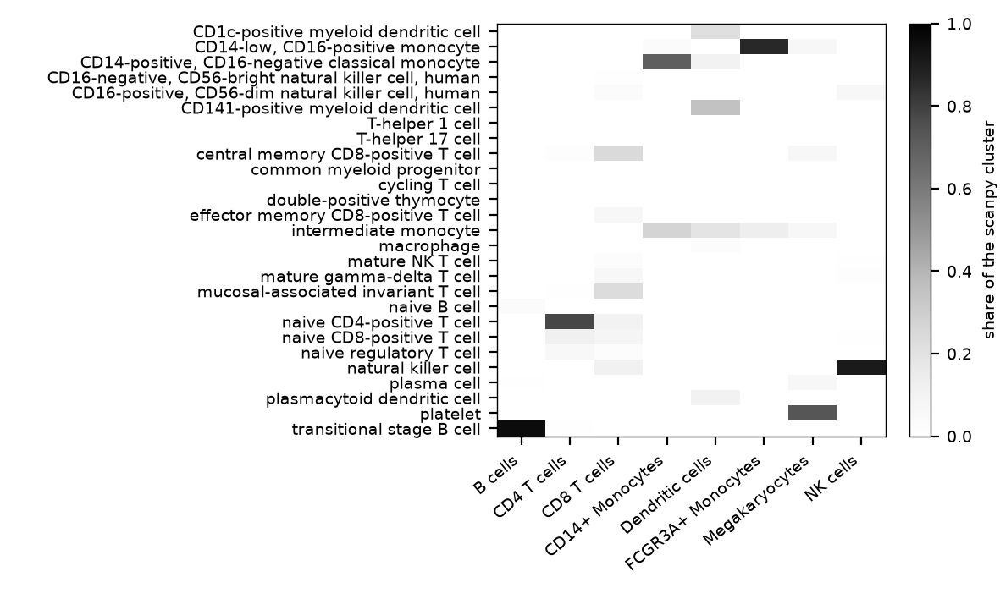
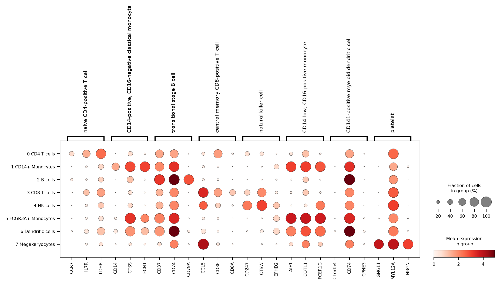

# PBMC3K showcase of annotation-consensus

The consensus labels eight PBMC3K clusters from three public tools plus a marker vote. Five clusters get a strict label, and three stay `Unknown` with a reason. All figures below were opened and checked. PBMC3K has one donor and no ground truth, so nothing here measures accuracy. The scanpy tutorial names are a reference, not truth.

## Run it

Paths are under a fresh `RUN` directory outside the repository (it must not exist).

```bash
RUN=/path/to/pbmc3k-run
.venv/bin/python 01_prep-pbmc3k.py $RUN                      # 2,638 cells, 8 clusters (codes), X_pca
$PUBLIC_MODELS_ENV/bin/python 02a_run-celltypist.py Immune_All_Low $RUN
# popV tabula_sapiens_Blood (GPU) and SingleR monaco_immune: the runners in cc-v8-work/public_models/
#   write tools/popv.tsv and tools/singler.tsv (barcode, predicted_label, predicted_cl_id, confidence)
.venv/bin/python 03_make-configs.py $RUN                      # config_h5.yaml, config_majority.yaml
for n in h5 majority; do
  .venv/bin/python ../../annotation_consensus.py run --input $RUN/config_$n.yaml --output $RUN/out_$n
  .venv/bin/python ../../annotation_consensus.py verify --input $RUN/config_$n.yaml --output $RUN/out_$n
done
.venv/bin/python 04_showcase-figures.py $RUN
```

Both runs passed `verify` (stored files and a rerun are byte-identical). The two runs differ only in the rule and the marker weight.

| Run | Rule | Marker weight | Values chosen by |
| --- | --- | --- | --- |
| 1 | h5 (tools + marker co-voter + ontology tie-break) | 1.0 | frozen demo values, user, 2026-11-13 |
| 2 | majority (tools only) | 0 | user, 2026-11-13 |

Shared values: gate 0.53, k 20 on `X_pca`, snap to vocabulary on, cell-level marker share, cluster gate 0.5 / 0.2 / 0.40. The 34-term vocabulary is inherited from the AIDA corpus run (`vocabulary.sha256`).

## What it shows

**The clusters** are the scanpy tutorial's, with a UMAP of the tutorial's own clustering as the layout.



`figures/fig1_umap.png`: the strict label follows the scanpy clusters for B cells, both monocyte groups and megakaryocytes. The CD8, NK and dendritic-cell clusters carry `Unknown` in the strict panel.

**The tools agree on five clusters and split on two.**



`figures/fig2_tool_votes.png`:
- All three tools call cluster 0 naive CD4 T. CellTypist and popV call cluster 2 transitional B, and CellTypist and SingleR call cluster 1 classical monocyte.
- Cluster 3 (CD8 T) gets three different calls, each below 0.5 of the cluster: central memory CD8 (CellTypist), naive CD4 (popV), mature gamma-delta T (SingleR).
- Cluster 6 (dendritic cells) also gets three calls: plasmacytoid DC, intermediate monocyte, CD141-positive DC.

**The marker vote lowers the cells called.**



`figures/fig3_runs.png`: run 1 labels fewer cells than run 2 in every cluster except megakaryocytes, where both are equal. The largest gap is NK cells, where run 2 labels the cluster `natural killer cell` and run 1 leaves it `Unknown` (`figures/cluster_table.tsv`). The marker vote is one extra voter, so it can pull a cell away from a tool majority. With no truth we cannot say whether those cells were right.

**Best guesses against the scanpy names.**



`figures/fig4_crosstab.png`: B cells, FCGR3A+ monocytes, NK cells and CD14+ monocytes each map mostly to one label. CD8 T cells spread over several T-cell labels, which matches the tool split in the tool-vote figure.

**The markers behind the labels.**



`figures/fig5_markers.png`: the first three vocabulary markers of each best-guess label are high in the matching cluster: CD79A and CD74 in B cells, GNG11, MYL12A and NRGN in megakaryocytes, CTSW and CD247 in NK cells. CCL5, the first marker of central memory CD8, is high in the CD8, NK and megakaryocyte clusters, so it does not separate CD8 T cells by itself.

## Limits

- One donor, eight clusters, no truth labels: no accuracy and no donor-level uncertainty.
- The vocabulary has no plain `B cell` or `CD4 T cell`, so those clusters get the nearest listed term (`transitional stage B cell`, `naive CD4-positive T cell`).
- The strict label of cluster 3 and cluster 6 is `Unknown` in both runs; their best guesses differ between runs for cluster 6.
